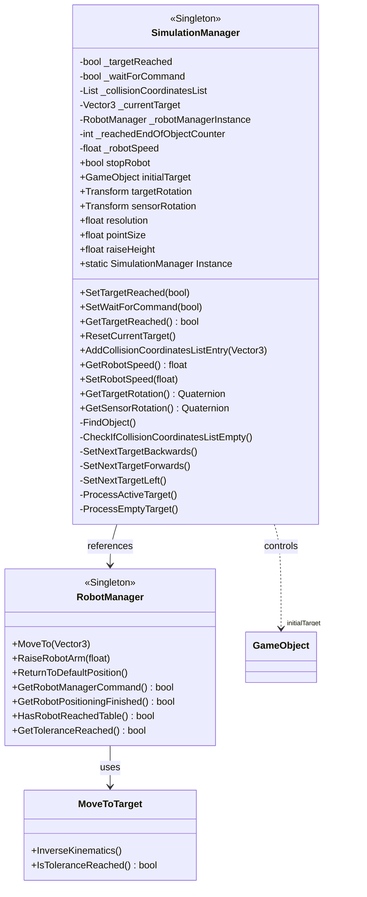

<think>I need to continue explaining the relationship between the scripts in the AR4 project. Let me summarize what I've learned so far from examining the scripts and provide a complete explanation of their relationships.</think>I apologize for the cutoff. Let me provide you with a complete explanation of the relationships between the script files in your AR4 project:

## Core System Structure

1. **SimulationManager.cs** - Central coordinator of the simulation
   - Singleton pattern implementation (accessible via `SimulationManager.Instance`)
   - Manages overall simulation state including robot movement, targets, and collision handling
   - Coordinates with RobotManager and other components
   - Controls simulation parameters like robot speed and resolution

2. **RobotManager.cs** - Manages the robotic arm
   - Singleton pattern implementation (accessible via `RobotManager.Instance`)
   - References to physical robot components (joints, gripper)
   - Configures robot parameters (stiffness, damping, force limits)
   - Contains the AR4 robot's physical specifications (joint lengths)
   - Works with MoveToTarget for motion control

3. **MoveToTarget.cs** - Handles inverse kinematics and robot movement
   - Calculates paths and distances to target positions
   - Implements robot movement logic using mathematical libraries
   - Coordinates with RobotManager for physical control
   - Manages end effector positioning and movement precision

## Collision Detection System

4. **GetSensorCollision.cs** - Detects collisions with sensor objects
   - Triggered when robot sensors hit objects in the environment
   - Communicates collision data to SimulationManager
   - Adjusts robot behavior when collisions occur
   - Used for object detection and mapping

5. **GetTabletopCollision.cs** - Specialized collision detection for tabletop
   - Signals when the robot reaches the table surface
   - Sets appropriate flags in RobotManager
   - Part of the spatial awareness system for the robot

6. **CreateObjectCloud.cs** - Visualizes collision points
   - Creates sphere primitives at collision locations
   - Used for building a visual representation of detected objects
   - Controlled by SimulationManager for visualization parameters (point size)

## Camera and Imaging System

7. **CameraCapture.cs** - Manages stereo camera image capture
   - Captures images from left and right cameras
   - Saves screenshots to disk for later processing
   - Provides functionality for visual data collection

8. **StereoCameraController.cs** - Controls stereo camera positioning
   - Manages the positioning of left and right cameras
   - Maintains proper interaxial distance for stereo vision
   - Simple but critical for proper stereo image capture

9. **FrameCapture.cs** - More generalized frame capture utility
   - Used for capturing frames from a single camera
   - Creates RenderTexture for high-quality captures
   - Manages storage of captured frames

## System Relationships

The system appears to be a robotic arm simulation focused on:
1. **Control hierarchy**: SimulationManager → RobotManager → MoveToTarget
2. **Collision detection**: GetSensorCollision and GetTabletopCollision feed data to SimulationManager
3. **Visualization**: CreateObjectCloud creates visual feedback of detected points
4. **Perception**: CameraCapture, StereoCameraController, and FrameCapture work together to provide vision capabilities

This structure supports a robot simulation that can detect objects, move to target positions, and capture visual data - typical operations for a robotic manipulation and sensing application. The AR4 in your project name likely refers to the AR4 robotic arm that's being simulated.

Would you like me to elaborate on any specific component or relationship in more detail?

## SimulationManager

