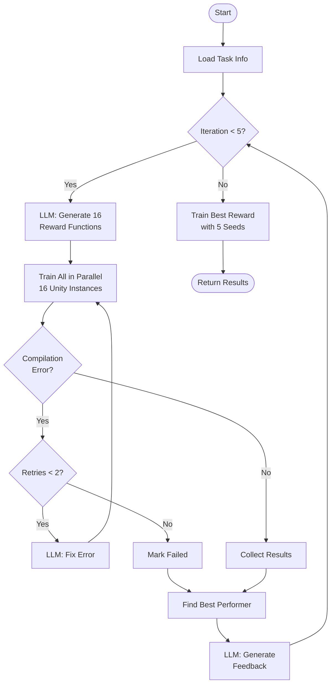
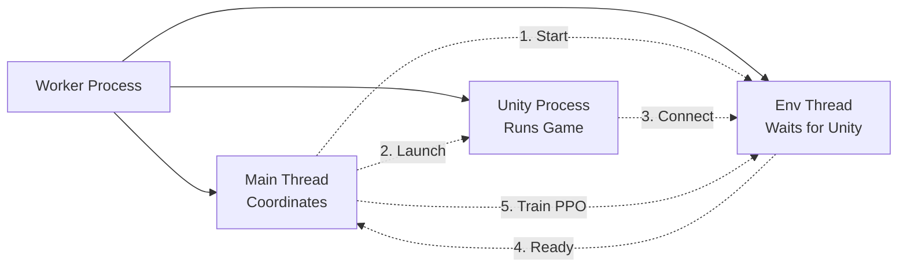

# Eureka Process Flow Diagram

## Simplified Essential Flow



## Threading and Process Architecture

### Main Process (Python)
```
Main Thread (eureka_main.py)
├── Manages overall iteration loop
├── Calls LLM for reward generation
└── Spawns Process Pool for parallel training
```

### Process Pool (multiprocessing)
```
Process Pool (16 workers max)
├── Worker Process 0
│   ├── Main Thread: Orchestrates training
│   ├── Environment Thread: Waits for Unity connection
│   └── Unity Subprocess: Runs simulation
├── Worker Process 1
│   ├── Main Thread: Orchestrates training
│   ├── Environment Thread: Waits for Unity connection
│   └── Unity Subprocess: Runs simulation
├── ... (up to 16 parallel workers)
```

### Per Training Run Threading



### Thread Synchronization Flow

1. **Worker Process** starts in process pool
2. **Main Thread** creates environment thread
3. **Environment Thread** starts listening on port (blocks waiting)
4. **Main Thread** launches Unity subprocess with port number
5. **Unity Process** starts and connects to port
6. **Environment Thread** receives connection, creates UnityVecEnv
7. **Main Thread** begins PPO training
8. **Unity Process** runs simulation, sends observations, receives actions
9. After training, cleanup in reverse order

## Component Breakdown

### Main Eureka Loop (`eureka_main.py`)

#### 1. **Initialization Phase**
- Loads configuration from YAML
- Initializes RewardLLM client (Azure OpenAI or OpenAI)
- Parses Unity agent file to extract:
  - Observation space details
  - Action space configuration
  - Task description and success criteria

#### 2. **Iterative Improvement Loop** (Default: 5 iterations)
- **Prompt Generation**: 
  - First iteration: Uses task description from agent file
  - Subsequent: Uses feedback from previous best performer
  
- **Batch Generation**:
  - Generates 16 reward function samples in parallel
  - Uses temperature variation for diversity
  - Saves all samples immediately for debugging

#### 3. **Parallel Evaluation**
- Launches multiple Unity instances simultaneously
- Each instance trains with different reward function
- Handles compilation errors with automatic retry mechanism

#### 4. **Feedback Generation**
- Analyzes all training results
- Identifies best performing reward function
- Generates feedback using policy performance metrics:
  - Success rate
  - Reward component statistics
  - Observation statistics

### Training Orchestrator (`training_orchestrator.py`)

#### 1. **Port Management**
```python
preferred_port = 5004 + run_id  # Each run gets unique port
actual_port = _find_free_port(preferred_port)
```

#### 2. **Threading Architecture**
- **Environment Thread**: Waits for Unity connection
- **Unity Process**: Launches with command-line arguments
- **Synchronization**: Thread blocks until Unity connects

#### 3. **Environment Pipeline**
```
UnityVecEnv → HybridActionWrapper → VecNormalize → PPO
```
- **UnityVecEnv**: Handles ML-Agents communication
- **HybridActionWrapper**: Converts Dict action space to Box for SB3
- **VecNormalize**: Normalizes observations and rewards
- **PPO**: Performs actual training

#### 4. **Error Handling**

##### Compilation Errors
1. Unity attempts to compile reward function
2. If compilation fails, writes error to JSON
3. Python detects error and triggers retry
4. LLM generates fixed version with error context
5. Process repeats (max 2 retries)

##### Runtime Errors
- Port conflicts: Automatically finds alternative port
- Unity crashes: Detected and logged
- Connection timeouts: 60-second timeout with retry

### Key Files and Paths

| File Type | Location | Purpose |
|-----------|----------|---------|
| Reward Functions | `rewards_dir/*.cs` | C# reward function code |
| Results | `results_dir/*.json` | Training statistics and metrics |
| Conversations | `conversations_dir/*.json` | LLM interaction history |
| TensorBoard | `tensorboard_dir/` | Training logs for visualization |

### Parallel Execution Details

The system uses Python's `multiprocessing.Pool` to manage parallel runs:

```python
with mp.Pool(processes=min(num_samples, mp.cpu_count())) as pool:
    # Submit training tasks
    for run_id in range(num_samples):
        async_result = pool.apply_async(
            self.train_with_reward, 
            args=(max_steps, seed, run_id, iteration, attempt)
        )
```

### Unity Integration

Unity receives parameters via command-line:
- `--mlagents-port`: Communication port
- `--reward-path`: Path to reward function file
- `--run-id`: Unique identifier for this run
- `--max-training-steps`: Total training steps
- `--output-file`: Where to write results

### Final Evaluation

After all iterations complete:
1. Best reward function identified
2. Trained with 5 different random seeds
3. Each seed trains for 2x normal steps
4. Results aggregated for statistical significance
5. Returns mean ± std deviation of success rate

## Success Metrics

The system tracks multiple metrics:
- **Success Rate**: Primary optimization target
- **Reward Components**: Individual reward term statistics
- **Observation Statistics**: Agent's perception of environment
- **Training Time**: Performance benchmarking
- **Episode Count**: Learning efficiency

## Configuration Parameters

Key configuration options in `eureka_config.yaml`:
- `iterations`: Number of Eureka iterations (default: 5)
- `samples`: Reward functions per iteration (default: 16)
- `max_training_steps`: Steps per training run (default: 100,000)
- `compilation_retries`: Max retries for compilation errors (default: 2)
- `parallel_envs`: Unity agents per instance (default: 9)